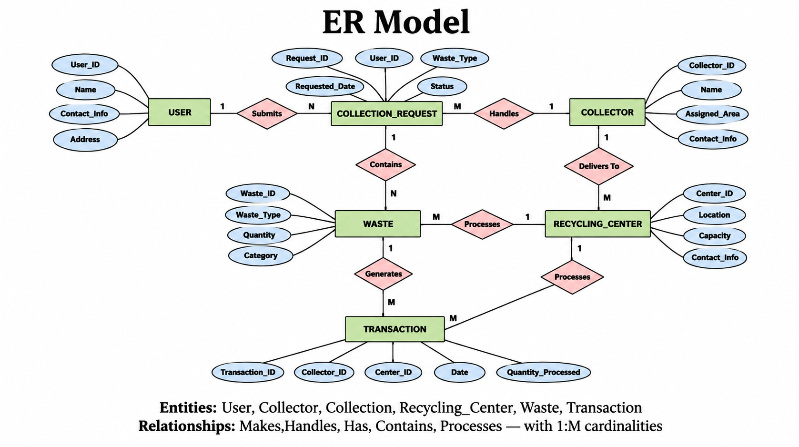

# ♻️ Recycling Management System (RMS)

A MySQL-based Database Management System designed to manage waste collection requests, collectors, recycling centers, waste records, and recycling transactions.


## 📌 Project Overview

The Recycling Management System (RMS) provides a structured database solution for managing recyclable waste and collection activities.

The system maintains user information, collection requests, collector assignments, waste records, recycling center details, and recycling transactions.

It aims to reduce data redundancy, maintain data consistency, enforce data integrity, and support efficient retrieval of recycling information.

## 🎯 Objectives

- Manage user and collector information.
- Maintain waste collection requests and their status.
- Store waste types, quantities, and categories.
- Manage recycling centers and their capacity.
- Record recycling transactions and processed quantities.
- Retrieve information using SQL queries, joins, and aggregate functions.

## 🛠️ Technologies Used

| Technology | Purpose |
|---|---|
| MySQL | Database management |
| SQL | Database operations and queries |
| MySQL Workbench | Database development and execution |

## 🗄️ Database Design

The project consists of six main tables:

1. **Users** – Stores user information.
2. **Collector** – Stores collector details and assigned areas.
3. **Collection_Request** – Maintains waste collection requests.
4. **Waste** – Stores waste types, quantities, and categories.
5. **Recycling_Center** – Maintains recycling center information and capacity.
6. **Transactions** – Records recycling and waste-processing activities.

### Entity Relationship Diagram



## ⚙️ Key Database Concepts Implemented

- Entity–Relationship (ER) modeling
- Relational schema design
- Primary and foreign keys
- Database normalization up to 3NF
- SQL DDL and DML operations
- CRUD operations
- INNER JOIN and LEFT JOIN
- Aggregate functions and GROUP BY
- Data integrity constraints
- Indexes
- Views
- Stored procedures
- Triggers

## 🔍 Advanced SQL Features

### Views

Three database views are implemented:

| View | Description |
|---|---|
| `request_details` | Displays collection requests with user and collector details |
| `center_utilization` | Displays recycling center capacity and processed quantity |
| `collector_summary` | Displays collectors and the number of requests handled |

### Stored Procedure

**`assign_collector`**

Assigns a collector to a pending collection request and updates its status to `Assigned`.

### Trigger

**`check_quantity`**

Validates the processed waste quantity before inserting a transaction. It prevents processing quantities greater than the available waste quantity.

## 📂 Repository Structure

```text
Recycling_Management_System/
│
├── README.md
│
├── sql/
│   ├── README.md
│   └── Recycling_Management_System.sql
│
├── Documentation/
│   └── RMS_Project_Documentation.pdf
│
├── ER_Diagram/
│   └── ER_Diagram.png
│
├── Presentations/
│   └── Project Presentation.pptx
│
└── Screenshots/
    ├── 01_Database_Table_Creation.png
    ├── 02_Sample_Data_Insertion.png
    ├── 03_Basic_SQL_Query_Outputs.png
    ├── 04_Join_Query_Output.png
    ├── 05_Aggregate_Query_Outputs.png
    ├── 06_Views_Execution.png
    ├── 07_Stored_Procedure_Execution.png
    └── 08_Trigger_Execution.png
```

## 🚀 How to Run the Project

1. Install MySQL Server and MySQL Workbench.
2. Clone or download this repository.
3. Open the SQL implementation file from the `sql` folder in MySQL Workbench.
4. Execute the SQL script to create the database, tables, constraints, indexes, triggers, sample data, views, and stored procedure.
5. Verify the created tables and execute the queries.
6. Test the views, stored procedure, and trigger.

## 📸 Project Screenshots

The [Screenshots folder](Screenshots/) contains execution results demonstrating:

- Database and table creation
- Sample data insertion
- Basic SQL operations
- JOIN operations
- Aggregate queries
- View execution
- Stored procedure execution
- Trigger execution

## 👥 Project Team

- M. Muni Kiran
- R. Lilly
- A. Jahnavi
- A. Mokshita

## 👨‍🏫 Project
